# Results

Generated automatically by `python run_all.py`. All numbers come from the simulator.

## 1. Two-body propagation (ISS-like orbit, 24 h)

| Quantity | Value |
|---|---|
| Propagated | 86400 s (15.49 orbits, 4321 samples) |
| Element round-trip error r,v → 6 COE → r,v (worst) | 1.5e-07 m |
| DOP853 position error vs analytic Kepler after 24 h | 3.07e-04 m |
| Relative energy drift over 24 h | 3.6e-12 |
| Hand-written RK4: measured order of convergence | 4.19 (theory: 4) |
| Ground-track westward shift per orbit | 23.31° |

RK4 position error after one orbit:

| Step [s] | Error [m] |
|---|---|
| 120 | 578.713 |
| 60 | 28.276 |
| 30 | 1.522 |
| 15 | 0.087 |
| 7.5 | 0.005 |

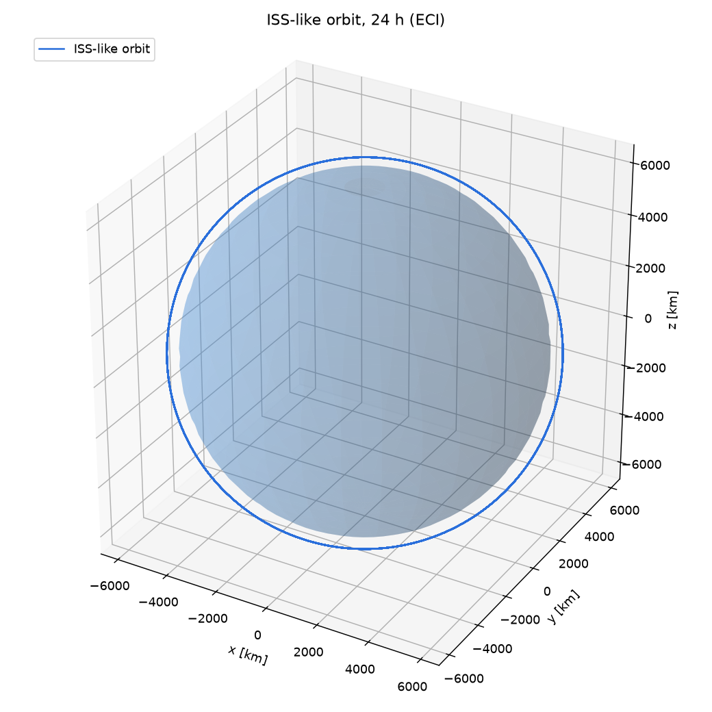
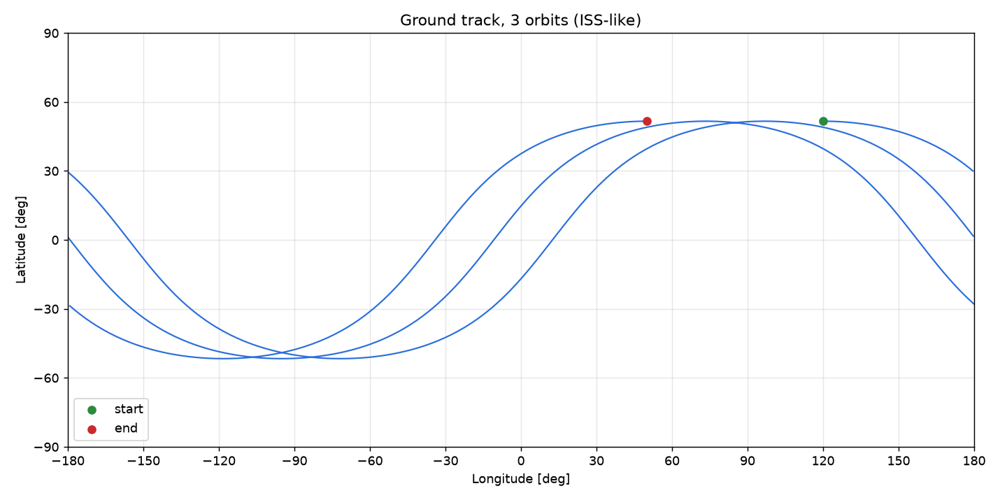
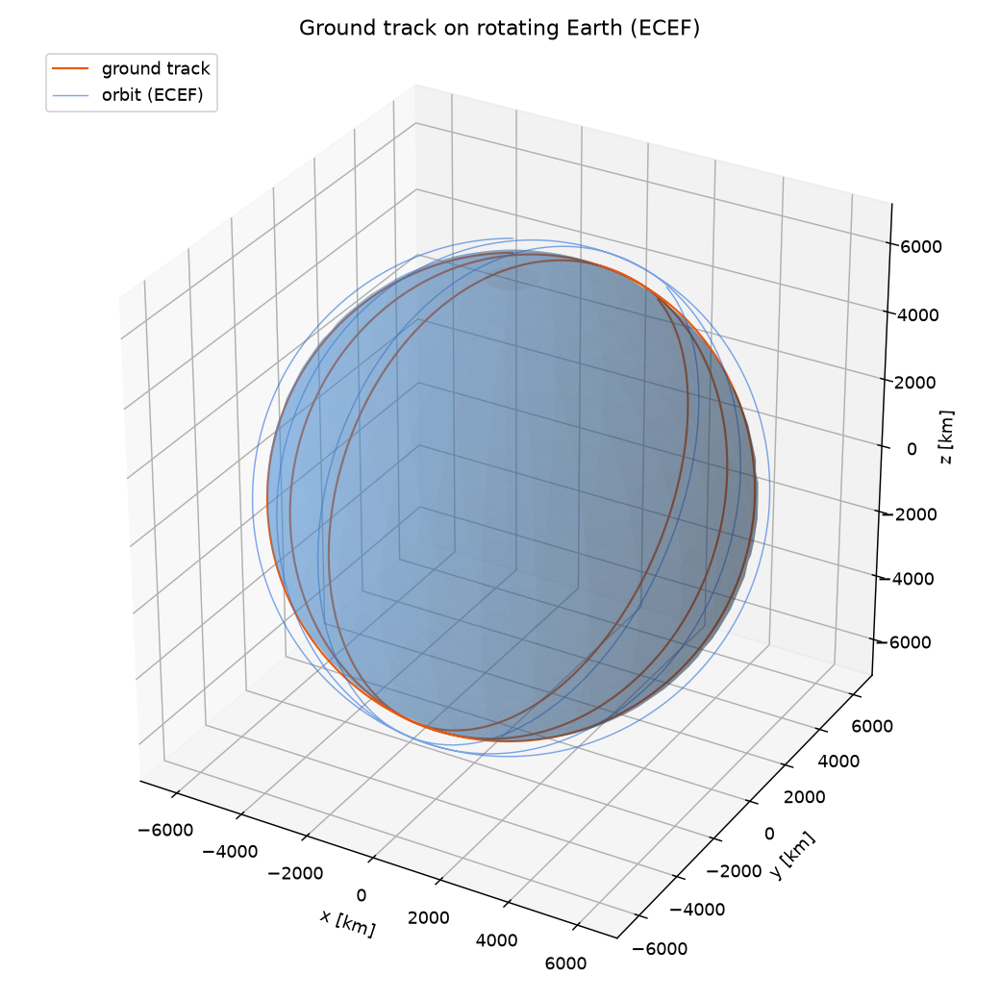
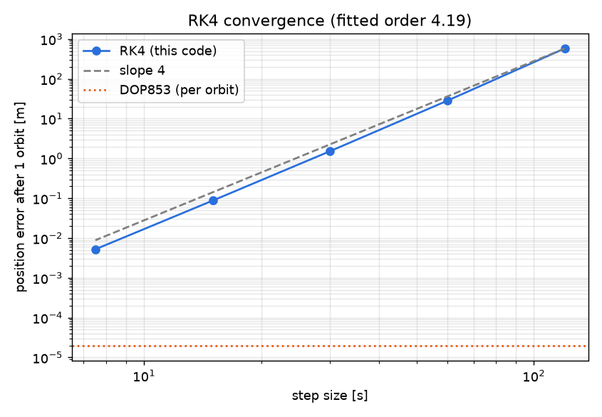

## 2. Hohmann transfers: analytic vs numerical

| Case | Integrator | Δv₁ [km/s] | Δv₂ [km/s] | Total [km/s] | TOF [h] | Arrival radius error | Δv₂ error |
|---|---|---|---|---|---|---|---|
| LEO 300 km -> GEO | DOP853 | +2.4257 | +1.4668 | 3.8926 | 5.275 | 2.2e-09 % | 1.2e-10 % |
| LEO 300 km -> GEO | RK4 (dt=60s) | +2.4257 | +1.4668 | 3.8926 | 5.275 | 1.6e-04 % | 5.6e-06 % |
| LEO 400 km -> 800 km | DOP853 | +0.1091 | +0.1076 | 0.2167 | 0.806 | 5.8e-10 % | 1.3e-08 % |
| LEO 400 km -> 800 km | RK4 (dt=60s) | +0.1091 | +0.1076 | 0.2167 | 0.806 | 7.0e-05 % | 2.0e-03 % |
| LEO 500 km -> MEO 20,200 km (GPS) | DOP853 | +1.9830 | +1.3894 | 3.3724 | 2.991 | 2.1e-09 % | 2.1e-10 % |
| LEO 500 km -> MEO 20,200 km (GPS) | RK4 (dt=60s) | +1.9830 | +1.3894 | 3.3724 | 2.991 | 8.4e-05 % | 3.0e-05 % |
| GEO -> LEO 400 km (lowering) | DOP853 | -1.4565 | -2.3975 | 3.8540 | 5.291 | 4.3e-10 % | 1.8e-09 % |
| GEO -> LEO 400 km (lowering) | RK4 (dt=60s) | -1.4565 | -2.3975 | 3.8540 | 5.291 | 1.8e-05 % | 3.9e-05 % |

Bi-elliptic transfer (r_b = 2.5 r₂) becomes cheaper than Hohmann above r₂/r₁ ≈ 13.5.

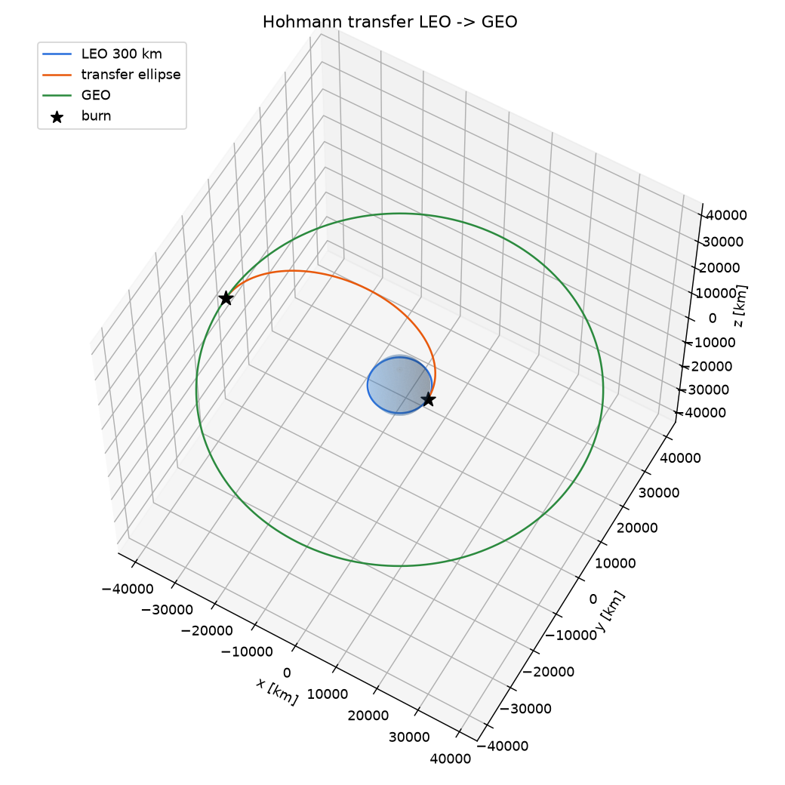
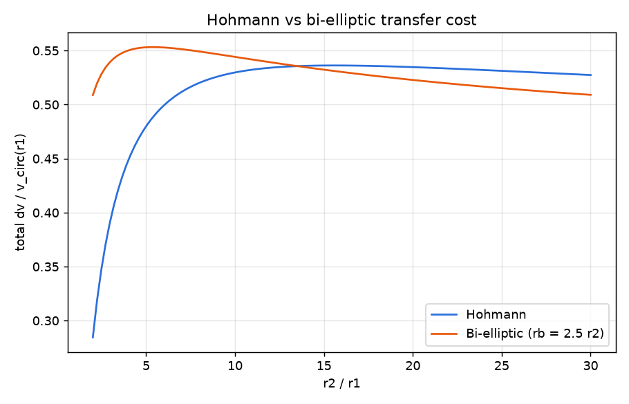

## 3. Single-burn plane changes

| Case | v [km/s] | Δv formula 2v·sin(Δi/2) [km/s] | Δv simulated [km/s] | Inclination after [°] |
|---|---|---|---|---|
| LEO 400 km: 51.6 -> 45 deg | 7.6686 | 0.8829 | 0.8829 | 45.0000 |
| LEO 300 km: 28.5 -> 0 deg | 7.7258 | 3.8034 | 3.8034 | 0.0000 |
| GEO: 28.5 -> 0 deg | 3.0747 | 1.5137 | 1.5137 | 0.0000 |
| LEO 700 km: 97 -> 98.2 deg | 7.5043 | 0.1572 | 0.1572 | 98.2000 |

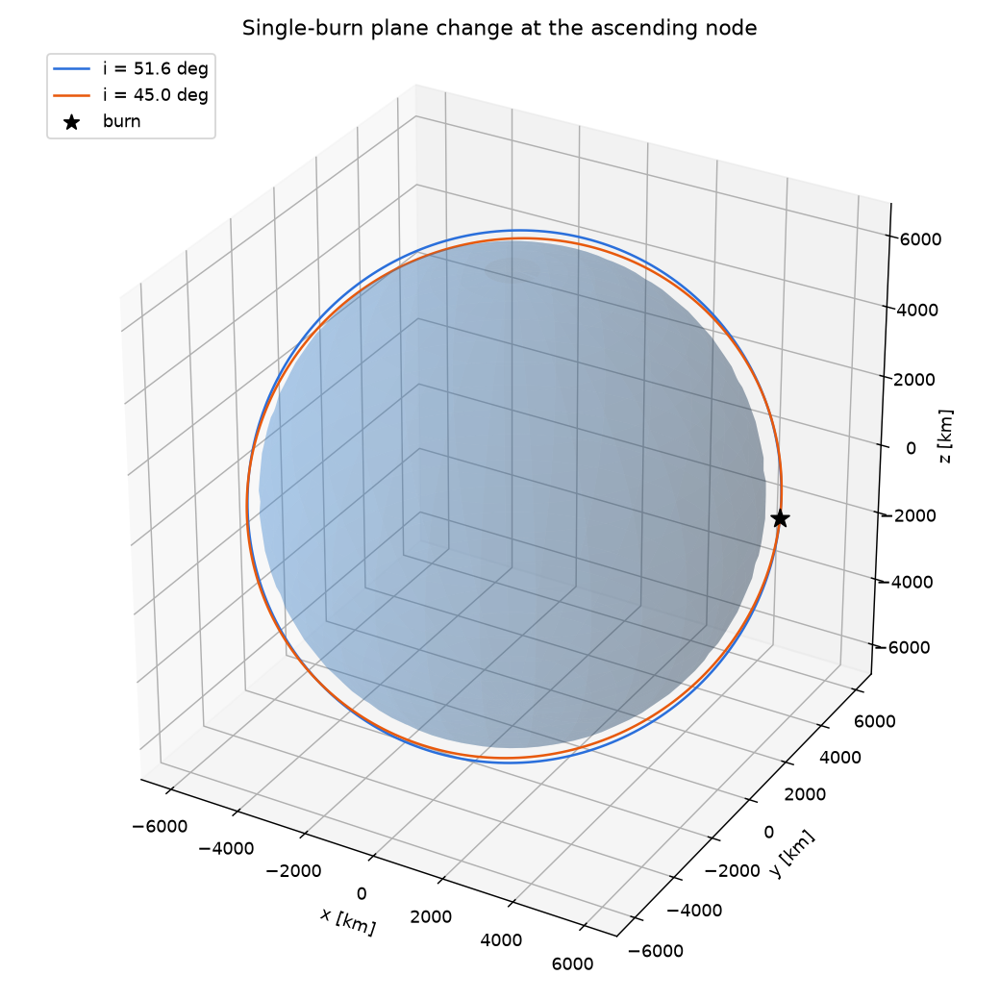
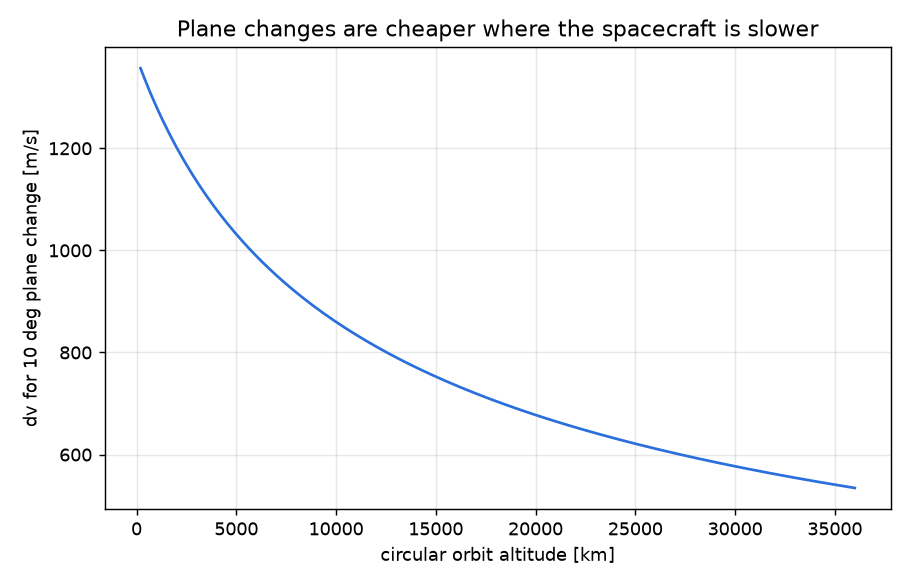

## 4. Reaction-wheel PID attitude control

Spacecraft J = diag(2.0, 2.5, 1.8) kg·m², wheels limited to 0.2 N·m and 1 N·m·s.

| Quantity | Value |
|---|---|
| Slew (roll 20°, pitch −15°, yaw 30°) | 40.8° eigen-axis |
| Settling time (2 % band) | **5.47 s** |
| Time to stay within 0.1° | 12.91 s |
| Overshoot | 0.157° |
| Peak torque / wheel momentum | 0.20 N·m / 0.345 N·m·s |
| Steady-state error with disturbance torque, PD | 0.0800° |
| Steady-state error with disturbance torque, PID | 0.00046° |

| ωn [rad/s] | Settling [s] | Overshoot [°] | Peak wheel momentum [N·m·s] |
|---|---|---|---|
| 0.4 | 11.83 | 0.143 | 0.157 |
| 0.6 | 8.01 | 0.158 | 0.234 |
| 0.8 | 6.36 | 0.157 | 0.297 |
| 1.0 | 5.47 | 0.157 | 0.345 |
| 1.2 | 4.93 | 0.156 | 0.381 |
| 1.5 | 4.10 | 0.326 | 0.422 |
| 2.0 | 6.40 | 4.914 | 0.466 |

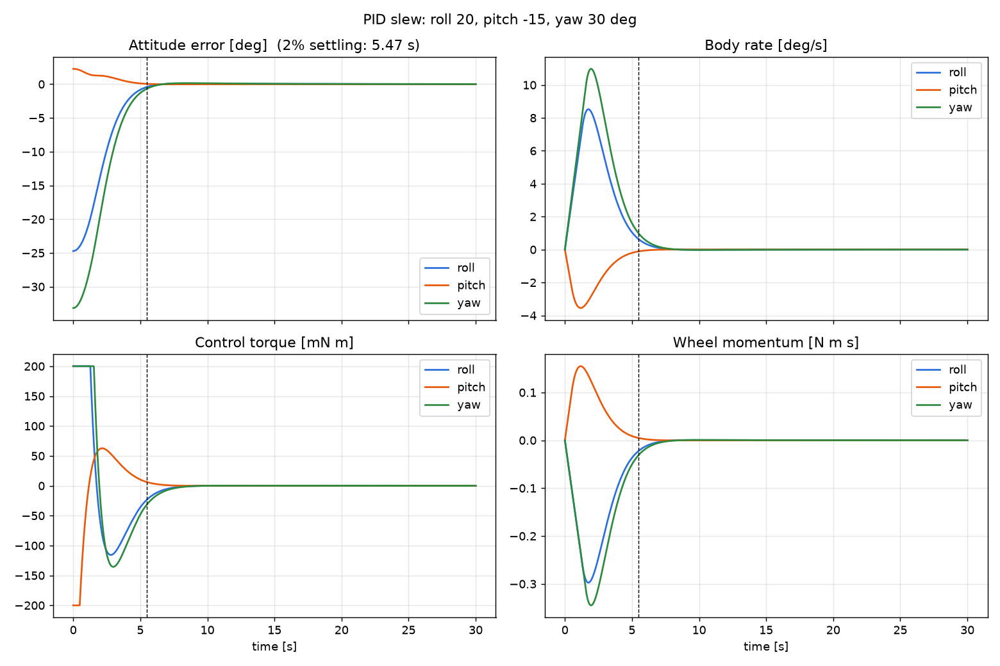
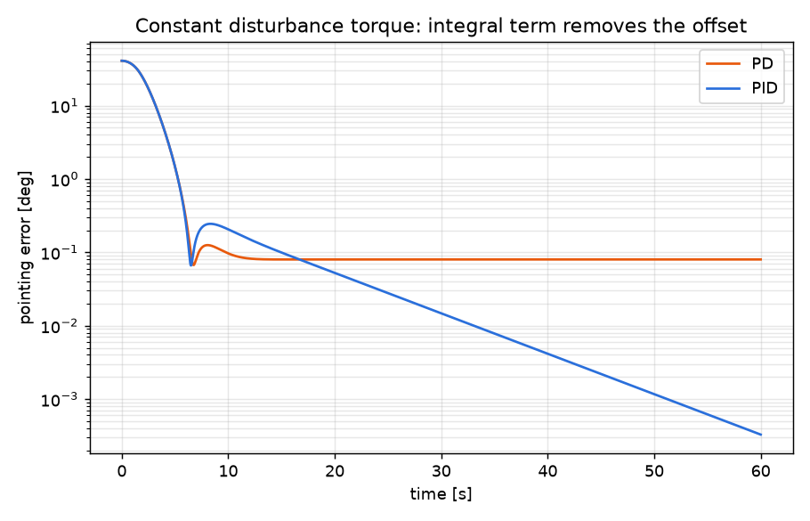

## 5. J2 perturbation (10-day numerical runs vs secular theory)

Sun-synchronous inclination at 700 km: **98.188°** (required precession 0.9856°/day).

| Orbit | i [°] | RAAN rate sim [°/day] | RAAN rate theory [°/day] | Difference |
|---|---|---|---|---|
| SSO 700 km | 98.19 | +0.9900 | +0.9856 | 0.44 % |
| ISS 420 km, 51.64 deg | 51.64 | -4.9680 | -4.9466 | 0.43 % |
| Molniya-type, 63.4 deg | 63.40 | -0.1456 | -0.1472 | 1.03 % |
| Eccentric LEO, 30 deg | 30.00 | -4.2182 | -4.2038 | 0.34 % |

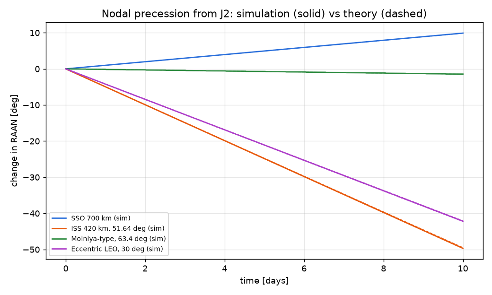
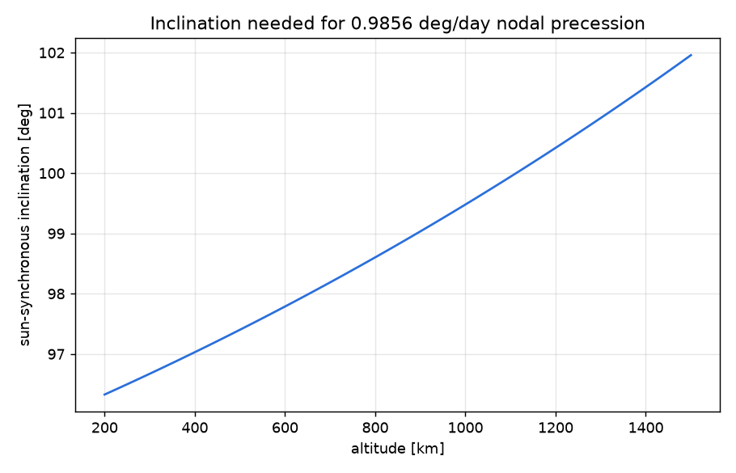

## 6. Drag decay from 300 km (J2 + drag, re-entry at 100 km)

| Spacecraft | Cd·A/m [m²/kg] | Lifetime [days] | Orbits |
|---|---|---|---|
| 3U CubeSat, high drag (0.034 m^2) | 0.0187 | 19.0 | 302 |
| 3U CubeSat, low drag (0.010 m^2) | 0.0055 | 64.4 | 1025 |
| 6U CubeSat, 12 kg (0.022 m^2) | 0.0040 | 87.9 | 1398 |

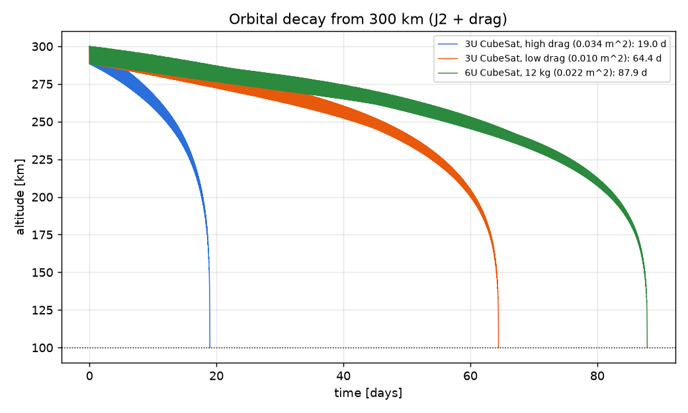

## 7. Mission planning: 300 km / 28.5° parking orbit → GEO (2,000 kg, Isp 320 s, with J2)

| Strategy | Total Δv [m/s] | Propellant [kg] | Final a [km] | Final i [°] |
|---|---|---|---|---|
| A: plane change in LEO, then Hohmann | 7,701.0 | 1,828.1 | 42,163.998 | 0.0000 |
| B: plane change combined with apogee burn | 4,257.5 | 1,485.0 | 42,163.998 | 0.0000 |
| C: optimal split (2.20 deg at perigee) | 4,235.6 | 1,481.4 | 42,163.998 | 0.0000 |

Analytic optimum: remove 2.20° at perigee → 4,231.3 m/s.

**A: plane change in LEO, then Hohmann**

```
Burn                                      t [h]   dv [m/s]  prop [kg]  mass [kg]
Plane change to 0 deg                     4.324     3807.7     1405.6      594.4
Hohmann burn 1 (r=6676 km)                4.324     2426.7      320.1      274.3
Hohmann burn 2 (r=42164 km)               9.598     1466.6      102.4      171.9
TOTAL                                    33.598     7701.0     1828.1
Final orbit: a=42163.998 km, e=0.000001, i=0.0000 deg, RAAN=0.0000 deg, argp=269.1114 deg, nu=270.5006 deg
```

**B: plane change combined with apogee burn**

```
Burn                                      t [h]   dv [m/s]  prop [kg]  mass [kg]
Hohmann burn 1 (r=6676 km)                4.324     2426.7     1077.0      923.0
Burn 2 + plane change to 0 deg            9.598     1830.3      407.9      515.1
Inclination trim at GEO node             15.581        0.5        0.1      515.0
TOTAL                                    39.581     4257.5     1485.0
Final orbit: a=42163.998 km, e=0.000053, i=0.0000 deg, RAAN=0.0000 deg, argp=314.0680 deg, nu=315.4984 deg
```

**C: optimal split (2.20 deg at perigee)**

```
Burn                                      t [h]   dv [m/s]  prop [kg]  mass [kg]
Burn 1 + plane change to 26.2998 deg      4.324     2450.8     1084.1      915.9
Burn 2 + plane change to 0 deg            9.599     1781.6      396.8      519.2
Inclination trim at GEO node             15.582        3.2        0.5      518.6
TOTAL                                    39.582     4235.6     1481.4
Final orbit: a=42163.998 km, e=0.000053, i=0.0000 deg, RAAN=0.0000 deg, argp=314.1698 deg, nu=315.4984 deg
```

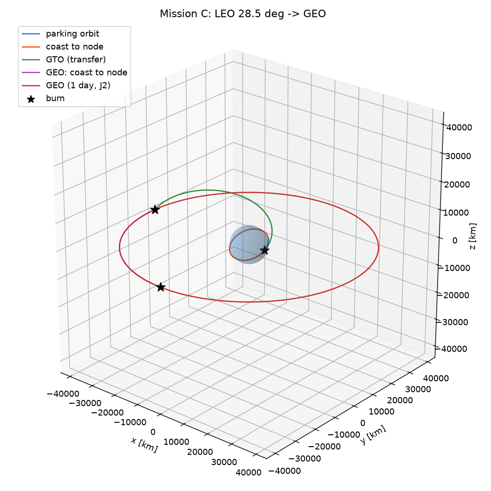
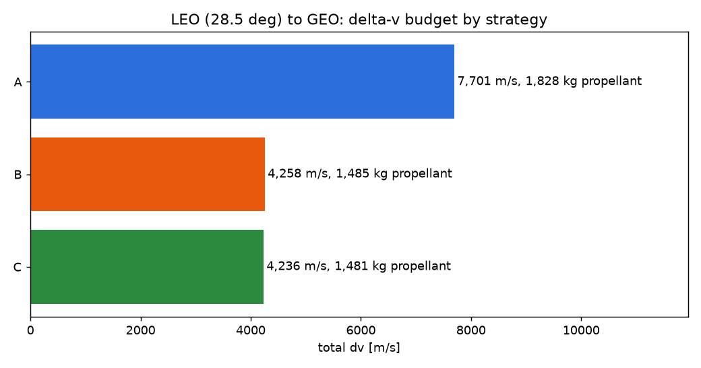
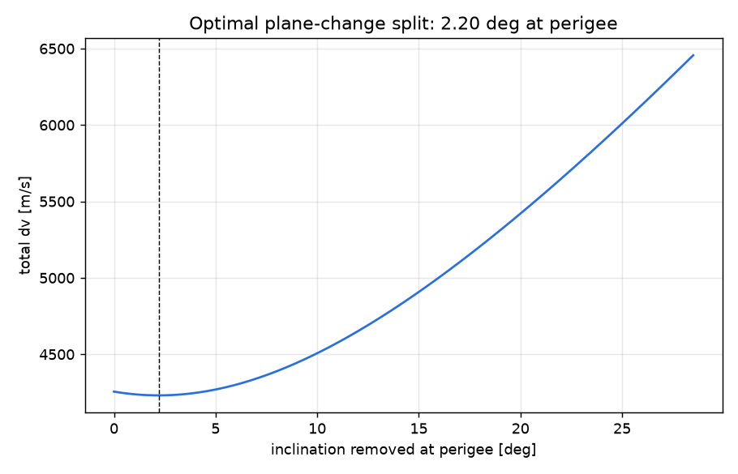
